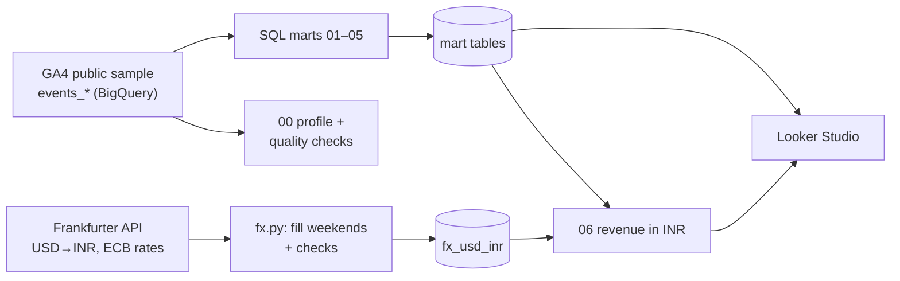

# 📊 GA4 E-commerce Analytics on BigQuery


SQL analytics on **3 months of real Google Analytics 4 data** from the Google Merchandise Store
(Google's public GA4 sample in BigQuery). A small Python pipeline profiles the raw export, runs data
quality checks, builds six reporting tables ("marts"), pulls daily **USD → INR rates from a public API**
to report revenue in rupees, and feeds a **Looker Studio** dashboard.

**Dashboard:** _Looker Studio link here_ · build guide: [`dashboard/LOOKER_STUDIO.md`](dashboard/LOOKER_STUDIO.md)

## What each query answers

| File | Question | SQL used |
|---|---|---|
| [`00_profile_and_quality.sql`](sql/00_profile_and_quality.sql) | Is the raw data complete and clean enough to trust? | `COUNTIF`, `DATE_DIFF`, nested `UNNEST` |
| [`01_daily_kpis.sql`](sql/01_daily_kpis.sql) | Users, sessions, purchases, revenue and conversion per day | session rebuild from `event_params`, `SAFE_DIVIDE` |
| [`02_traffic_sources.sql`](sql/02_traffic_sources.sql) | Which channels bring users who buy? | struct fields, conditional distinct counts |
| [`03_funnel.sql`](sql/03_funnel.sql) | Where do shoppers drop off between view and purchase? | `UNION ALL`, `FIRST_VALUE`, `LAG` |
| [`04_rolling_trends.sql`](sql/04_rolling_trends.sql) | Is traffic going up or down once daily noise is smoothed? | 7-day rolling `AVG() OVER`, `LAG`, named `WINDOW` |
| [`05_top_products.sql`](sql/05_top_products.sql) | Best sellers inside each category | `UNNEST(items)`, `RANK() OVER (PARTITION BY)`, `QUALIFY` |
| [`06_revenue_inr.sql`](sql/06_revenue_inr.sql) | Daily revenue in rupees | join with the API-loaded FX table |

## Results

<!-- RESULTS:START -->
_Run the pipeline (see "Run it" below) to fill this section with real numbers._
<!-- RESULTS:END -->

## How it works



`python -m ga4.pipeline --project <id>` runs everything in order:

1. **FX rates:** calls the Frankfurter API for daily USD→INR rates, fills weekends and holidays with the last
   known rate, checks the result, and loads it into BigQuery with a load job.
2. **Profile:** one pass over the raw export for totals and data quality counts. A **FAIL** stops the run
   before any table is built; a **WARN** is reported and the run continues.
3. **Marts:** each SQL file is saved as a table (`mart_daily_kpis`, `mart_funnel`, ...) that the dashboard reads.
4. **Report:** marts are exported to `results/*.csv` and the Results section above is rewritten.

## Data quality rules

| Rule | Level |
|---|---|
| Every day in the range has data (a missing day would break rolling averages and week-over-week) | FAIL |
| No events without `user_pseudo_id` | FAIL |
| One FX rate for every calendar day, no gaps, every value between 40 and 150 | FAIL |
| INR revenue present for every day after the join | FAIL |
| Events without `ga_session_id` under 1%, duplicate events under 0.1% | WARN |
| Purchases without revenue under 5%, purchases with a hidden transaction id | WARN |
| FX day-to-day change under 3%, funnel never grows from one step to the next | WARN |

Every run writes the full list with values to `results/data_quality.csv`.

## Decisions worth knowing

- **Sessions** are rebuilt as `user_pseudo_id + ga_session_id`, the standard approach for the GA4 export.
  A session that crosses midnight counts on both days in the daily table; period totals use a distinct count.
- **`traffic_source` is first touch.** In the GA4 export it is the channel that first acquired the user, so
  the channel table reads "users first acquired by Google organic", not "sessions from Google organic".
- **Open funnel.** A user counts at a step if they fired that event at any time in the period, like GA4's
  open funnel. It is simple and fast; the cost is that steps are not forced into order, so a check warns
  if a later step is ever bigger than an earlier one.
- **Cost control.** Every query filters `_TABLE_SUFFIX` to the date range and names only the columns it needs,
  because BigQuery bills by data scanned. A test fails if any query does `SELECT *` on the raw export.
- **FX from one source.** `providers=ECB` keeps reruns reproducible. ECB publishes on working days only, so
  weekend rates are carried forward, the fetch starts 7 days early (1 Nov 2020 was a Sunday), and an
  `is_filled` flag keeps carried rates visible.
- **Sandbox friendly.** The BigQuery sandbox has no streaming inserts or DML, so data goes in with load
  jobs and query results are written as destination tables. Sandbox tables expire after 60 days; rerun to refresh.

## Run it

**Google Colab (easiest, free):** [](https://colab.research.google.com/github/Krishna945-crtl/ga4-bigquery-analytics/blob/main/notebooks/run_on_colab.ipynb)
open [`notebooks/run_on_colab.ipynb`](notebooks/run_on_colab.ipynb) in Colab and run the cells. It signs you in to Google, runs the pipeline and gives you the updated README and results.

You need a Google Cloud project with BigQuery enabled. The free
[BigQuery sandbox](https://cloud.google.com/bigquery/docs/sandbox) works and needs no credit card.

**Locally:**

```bash
pip install -r requirements.txt
gcloud auth application-default login
python -m ga4.pipeline --project your-project-id
```

## Tests

```bash
pytest -q    # offline, no Google Cloud account needed
```

The tests run the same `sql/` files on **DuckDB**: [sqlglot](https://github.com/tobymao/sqlglot) translates
the BigQuery SQL, and a small hand-made GA4-shaped dataset gives answers checked by hand (2 users on day one,
a duplicate event, a purchase with no revenue, a user with no session id, and so on). A second dataset
covers all 92 days and runs the whole pipeline end to end with a fake FX API, so GitHub Actions checks the
SQL logic, the data quality rules and the README report on every push.

## Limitations

- The sample is **obfuscated** by Google: some fields hold placeholders such as `<Other>`, `NULL` or `''`, so
  numbers are good for practising analysis, not for real business decisions. Product rankings skip placeholder names.
- Three months only (Nov 2020 – Jan 2021), and that includes the holiday season.
- The open funnel does not check the order of steps inside a session.

## Data and credits

- [GA4 obfuscated sample e-commerce dataset](https://developers.google.com/analytics/bigquery/web-ecommerce-demo-dataset),
  `bigquery-public-data.ga4_obfuscated_sample_ecommerce`, published by Google.
- Exchange rates from the [Frankfurter API](https://frankfurter.dev), European Central Bank reference rates.
